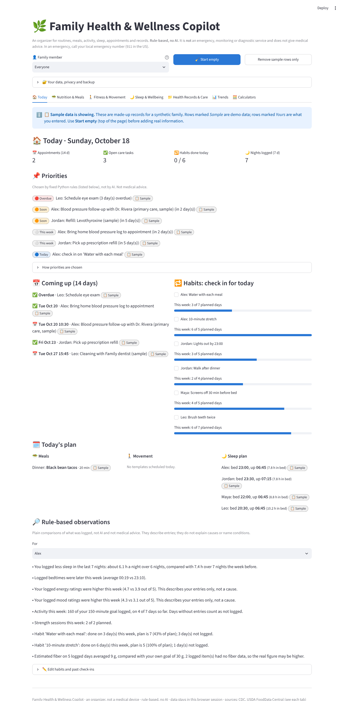

# 🌿 Family Health & Wellness Copilot

A simple Streamlit app that helps a family organize wellness routines, meals, activity, sleep,
appointments and health records in one place.

- **No API keys, secrets, login, database, paid service or AI API.** Every summary comes from plain
  Python rules you can read in the code.
- **Private by design.** Records live only in your browser session. Nothing is sent to an outside service.
- **An organizer, not a medical tool.** It is not an emergency, monitoring or diagnostic service and does
  not give medical advice. In an emergency, call your local emergency number.



## What's inside

| Tab | What you can do |
|---|---|
| 🏠 **Today** | Upcoming appointments and confirmed care tasks, today's meals, movement and sleep plan, habit check-ins with weekly progress, rule-based priorities and observations. Sample rows are badged *Sample*, your rows *Yours*. |
| 🥗 **Nutrition & Meals** | Editable weekly planner, consolidated grocery list, preferences / allergies / restrictions / prep time, a 19-food USDA dataset with portion sizes, meal log with estimated calories, protein, carbs, fat and fiber. Missing data is shown as missing, never as zero. Your own goals only. |
| 🚶 **Fitness & Movement** | Log walking, activity minutes, steps, strength and mobility; personal weekly goals with progress bars; editable templates with gentle weekly progression up to a cap you choose. |
| 🌙 **Sleep & Wellbeing** | Bedtime, wake time (handles midnight), estimated sleep, energy, mood, stress and optional journal notes. |
| 📁 **Health Records & Care** | Profiles per family member; measurements, visits, vaccinations, clinician-provided instructions (kept separate), medications with user-confirmed prescribed schedules and refill dates, care tasks, appointments, question lists, prep checklists, in-app reminders, `.ics` calendar download, and text-only PDF reading. |
| 📊 **Trends** | Plotly charts for weight, blood pressure, activity minutes, steps, sleep duration and timing, mood/energy/stress, habit completion and nutrition estimates. Date and family-member filters, source tables and CSV downloads. Unlogged periods are gaps; averages are dashed and labelled. No "health score". |
| 🧮 **Calculators** | Adult BMI (metric/imperial), waist-to-height ratio, sleep duration, weekly activity totals, recipe nutrition per serving, habit completion %. Each explains inputs, formula, assumptions and limits. |

## Run it on your computer

You need Python 3.10 or newer.

```bash
git clone https://github.com/chennab12/health-admin-pilot.git
cd health-admin-pilot
python -m venv .venv
source .venv/bin/activate          # Windows: .venv\Scripts\activate
pip install -r requirements.txt
streamlit run app.py
```

The app opens at http://localhost:8501 with a **synthetic sample family** loaded. Click **🧹 Start empty**
to clear it, then add family members under **📁 Health Records & Care → Profiles**.

Run the tests:

```bash
pip install pytest
python -m pytest -q
```

## Put it on GitHub, then Streamlit Community Cloud

1. **Create or open the repository** `chennab12/health-admin-pilot` on GitHub.
2. **Push the code** (from the project folder):
   ```bash
   git init -b main            # skip if already a git repo
   git add .
   git status                  # check: no personal backups, CSVs, .ics or PDFs listed
   git commit -m "Family Health & Wellness Copilot"
   git remote add origin https://github.com/chennab12/health-admin-pilot.git
   git push -u origin main
   ```
3. Go to **https://share.streamlit.io**, sign in with GitHub, and choose **Create app → Deploy a public app
   from GitHub**.
4. Pick repository `chennab12/health-admin-pilot`, branch `main`, main file `app.py`. Optionally choose
   Python 3.12 under **Advanced settings**. No secrets are needed.
5. Click **Deploy**. Later pushes to `main` redeploy automatically.

The GitHub Action in `.github/workflows/tests.yml` runs the tests on every push.

## Your data and privacy

- **Session only.** Records are kept in Streamlit session state. They can disappear when the page reloads,
  the app restarts or the session times out. Use **🔐 Your data, privacy and backup → Download JSON backup**
  and restore it next time.
- **No family sharing yet.** There is no login. Each browser session is separate. To share, give a backup
  file to someone you trust.
- **Exports are sensitive.** JSON backups, CSVs, calendar files and prep sheets contain health information.
  Keep them private. `.gitignore` blocks these file types so they are not committed by accident.
- **Nothing leaves the app.** No analytics, AI services or external databases receive your entries
  (`.streamlit/config.toml` turns off Streamlit's usage statistics).
- **Minimal identifiers.** A first name or nickname and an optional birth year are enough.
- **Reminders work only while the app is open.** For real alerts, download the `.ics` file into your own
  calendar app. You can hide names and details in that file.

## How the app stays honest

- **Rule-based observations, not AI.** Summaries compare your own entries with your own goals or the
  previous week, for example *"You logged less sleep in the last 7 nights…"*. They never name causes or
  conditions, and need at least 3 entries per period or they say there is not enough data.
- **Unlogged ≠ didn't happen.** Days without entries are "not logged". Habit completion is unknown, not 0 %,
  when nothing was checked in.
- **Missing nutrition data stays missing.** Unknown foods, amounts or nutrients are counted and reported,
  so totals say how incomplete they are.
- **No silent interpolation.** Charts put daily data on a full calendar so gaps show; sparse readings break
  the line after 14 days; rolling averages use logged readings only and are drawn separately.
- **Validation.** Impossible values (for example a diastolic above systolic, weight in cm, 30 hours of sleep,
  future log dates) are listed under the table with row numbers and left out of charts until fixed.
- **Clinician instructions are separate.** They are shown exactly as you typed them, in their own style,
  apart from anything the app suggests.
- **Medications.** Names, the prescribed schedule you copied from the label, a "confirmed" tick, and refill
  dates. The app never recommends doses or changes.
- **PDFs.** Text-based PDFs are read with `pypdf` and shown as plain text. The app does not interpret them
  and has no OCR for scanned documents.

## Sources

Reference ranges appear only where a source was checked (on 2026-10-18):

| Used for | Source |
|---|---|
| Adult BMI categories (adults 20+ only) | [CDC: Adult BMI Categories](https://www.cdc.gov/bmi/adult-calculator/bmi-categories.html) |
| Children and teens use percentiles, not adult categories | [CDC: Child and Teen BMI Calculator](https://www.cdc.gov/bmi/child-teen-calculator/) |
| Recommended sleep hours by age | [CDC: About Sleep](https://www.cdc.gov/sleep/about/index.html) |
| Adult activity reference (150 min moderate, 2 strength days) | [CDC: Adult Activity, An Overview](https://www.cdc.gov/physical-activity-basics/guidelines/adults.html) |
| Food nutrients per 100 g | [USDA FoodData Central](https://fdc.nal.usda.gov/) (public domain, CC0). Each food lists its FDC ID. |

Deliberately **not** interpreted: blood pressure readings, waist-to-height ratio, and BMI for children,
teens or pregnancy. Portion weights in the food table are typical household measures chosen for this app,
not USDA values.

## Project layout

```
app.py              Streamlit layout: header, data controls and the seven tabs
calculations.py     BMI, unit conversions, waist-to-height, sleep across midnight, activity, habits
foods.py            USDA food dataset, nutrition estimates with missing-data counts, grocery list
insights.py         Rule-based observations and Today's priorities
reminders.py        Upcoming reminders, .ics calendar export, appointment prep checklist
charts.py           Plotly charts with gaps, long-gap breaks and labelled rolling averages
storage.py          Record schemas, validation, profile/date filters, JSON backup/restore
sample_data.py      Synthetic sample family (dates relative to today, with deliberate gaps)
sources.py          Verified reference sources and the ranges taken from them
data/sample-family-backup.json   The sample family as a backup file, for trying Restore
tests/              pytest tests, including a headless app run (Streamlit AppTest)
```

Beginner tips: every table is a list of plain dicts described in `storage.SCHEMAS`. To add a field, add it
there, then add a column to the matching `edit_table(...)` call in `app.py`.

## Limitations

- Data is lost when the session ends unless you export it. There is no login, sync or family sharing.
- Reminders are in-app only; no push, email or text notifications.
- The food dataset is small (19 foods). Add others under **My foods**.
- Nutrition values are estimates; real foods vary by brand, recipe and cooking.
- No OCR: scanned PDFs show no text.
- Allergy notes are simple text matches on what you typed. A missing note does not mean a meal is safe.
- Not a medical device. Always follow your clinician's advice.
